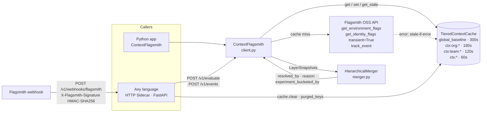

# flagsmith-contexts

**Hierarchical Multi-Context Evaluation, Tiered Caching & Account-Level Experimentation for Open-Source Flagsmith.**

`flagsmith-contexts` adds LaunchDarkly-style multi-context evaluation (`Global → Org → Team → User`) to Flagsmith OSS. It evaluates each layer as its own namespaced identity, merges them with reason-aware precedence, and serves them through a `stale-if-error` tiered cache. It also pins A/B/n assignments to the account across both control and treatment arms, and attributes conversions 1-to-1 to the bucketing context. It runs on stock Flagsmith OSS through the public Python SDK (v6.6.0) and REST API, with **zero forks or patches to Flagsmith core**.

Built for the WeMakeDevs **ToggleWars** hackathon (Nov 26–29, 2026).

---

## Problem vs. Solution

| Dimension | Stock Flagsmith (single identity) | `flagsmith-contexts` |
|---|---|---|
| **Multi-layer hierarchy inheritance** | One identity per evaluation. An org-level segment override is invisible to a user unless every org trait is copied onto every user. | Each layer (`org`, `team`, `user`, …) is evaluated as `ctx:{kind}:{id}`. A narrower layer overrides only on an explicit match (`TARGETING_MATCH`, `IDENTITY_OVERRIDE`, `SPLIT`) or a divergence from the baseline. Otherwise it inherits, and `resolved_by` names the winning layer. |
| **Cache efficiency across shared orgs** | Every user request re-fetches identical org state. | `TieredContextCache` stores `global_baseline` and each `ctx:{kind}:{id}` with per-tier TTLs (300s / 180s / 120s / 60s). Users in the same org reuse the baseline and org snapshots (measured: 596 ms cold → 0.3 ms warm). It serves expired snapshots when Flagsmith is unreachable. |
| **Account-level (B2B) experiment bucketing** | Users are hashed individually, so teammates in one account land in different variants. | With `bucketing_context="org"`, every experiment flag resolves to the org's assignment (`experiment_bucketed_by="org:<id>"`). Control-arm orgs (`STATIC`, no variant) are pinned too. |
| **Conversion event attribution** | Events attach to whichever identity happened to fire them. | `track_context_event` sends events to the bucketing identity (`ctx:org:acme_corp`) and attaches the full context trace in `metadata`. |

---

## Architecture



**Resolution rule (Dual-Check Override).** Layers are walked from broadest to narrowest, starting from the environment baseline. A layer replaces the current winner only if one of these holds:
1. Its `reason` is non-null and not `DEFAULT`/`STATIC`.
2. Its `(enabled, value)` differs from the baseline.

If neither holds, the layer inherits the ancestor's decision.

**Experiment bucketing.** When `bucketing_context` is set, a feature counts as an experiment if any evaluated layer reports a `variant` or a `SPLIT` reason. Each such feature is then pinned to the bucketing layer's snapshot.

---

## 5-Minute Quickstart

### 1. Boot Flagsmith OSS

```powershell
# Windows (starts a WSL keep-alive + Compose, waits for HTTP 200)
.\infra\start-flagsmith.ps1
```

```bash
# Any OS
docker compose -f infra/docker-compose.yml up -d
curl -s -o /dev/null -w "%{http_code}\n" http://localhost:8000/health   # → 200
```

Open `http://localhost:8000` and register; registration without an invite is enabled. Then create a project and configure its environment:

| Feature | Type | Configuration |
|---|---|---|
| `sso_login` | Standard | Off by default. Segment `enterprise_plan` (`plan == "enterprise"`) overrides it to **on**. |
| `onboarding_flow` | Multivariate | Enabled. Control value `classic`, variant `guided_ai` at 50%. |

Copy the environment's **Client-side Environment Key** (Environment → Settings → Keys).

### 2. Install and configure

```bash
python -m venv .venv
source .venv/bin/activate            # PowerShell: .\.venv\Scripts\Activate.ps1
pip install -e ".[dev]"
```

Create `.env` in the repo root:

```dotenv
FLAGSMITH_API_URL=http://localhost:8000/api/v1/
FLAGSMITH_ENV_KEY=<your environment key>
FLAGSMITH_WEBHOOK_SECRET=demo_secret
```

> `demo/seed_demo.py --simulate`, which seeds the features above automatically and runs a simulated experiment, will land with the `feat/sidecar-cache-demo` merge. Until then, use the manual setup above.

### 3. Run the tests

```bash
pytest -v                    # full suite (live tests skip cleanly if Flagsmith is down)
pytest -m integration -v     # 5 live tests against http://localhost:8000/api/v1/
```

---

## Python SDK

```python
from flagsmith_contexts import ContextFlagsmith, ContextLayer

client = ContextFlagsmith(
    environment_key="<FLAGSMITH_ENV_KEY>",
    api_url="http://localhost:8000/api/v1/",
)  # optional: cache=..., sdk_client=..., **Flagsmith kwargs

contexts = [
    ContextLayer(kind="org", id="acme_corp", traits={"plan": "enterprise"}),
    ContextLayer(kind="user", id="don", traits={"role": "member"}),
]

resp = client.get_context_flags(contexts=contexts, bucketing_context="org")

sso = resp.flags["sso_login"]
print(sso.enabled, sso.resolved_by, sso.reason)
# True org:acme_corp TARGETING_MATCH; segment=enterprise_plan

flow = resp.flags["onboarding_flow"]
print(flow.value, flow.experiment_bucketed_by)
# classic org:acme_corp   ← every acme_corp user gets the same arm

print(resp.meta)
# hierarchy=['ctx:org:acme_corp', 'ctx:user:don'] cache_hits=0 cache_misses=3 stale=False evaluation_ms=...

event = client.track_context_event(
    event_name="onboarding_completed",
    contexts=contexts,
    bucketing_context="org",
    value=1,
    metadata={"plan": "enterprise"},
)
print(event.attributed_to)   # org:acme_corp

client.ping()                # True if Flagsmith is reachable
```

`get_context_flags` also accepts a prebuilt `EvaluateRequest`, and `track_context_event` a `TrackEventRequest`. `include_baseline=False` skips the environment baseline. Each context is evaluated with `transient=True` by default (`ContextLayer.transient`), so synthetic `ctx:*` identities don't pollute the Identities table.

---

## HTTP Sidecar (FastAPI)

```bash
uvicorn --factory flagsmith_contexts.server:create_app_from_env --port 8080
```

`create_app_from_env()` reads `.env` / environment (`FLAGSMITH_ENV_KEY`, `FLAGSMITH_API_URL`, `FLAGSMITH_WEBHOOK_SECRET`) and wires a `ContextFlagsmith` engine plus its cache. To embed it in your own process, use `create_app(engine=client, cache=client.cache, webhook_secret=...)`.

The responses below were captured from a live run against local Flagsmith OSS.

**`POST /v1/evaluate`**

```bash
curl -s -X POST localhost:8080/v1/evaluate -H 'Content-Type: application/json' -d '{
  "contexts": [
    {"kind": "org",  "id": "acme_corp", "traits": {"plan": "enterprise"}},
    {"kind": "user", "id": "don",       "traits": {"role": "member"}}
  ],
  "bucketing_context": "org"
}'
```

```json
{
  "flags": {
    "onboarding_flow": {"enabled": true, "value": "classic", "resolved_by": "org:acme_corp",
                        "reason": "STATIC", "experiment_bucketed_by": "org:acme_corp"},
    "sso_login":       {"enabled": true, "value": null, "resolved_by": "org:acme_corp",
                        "reason": "TARGETING_MATCH; segment=enterprise_plan", "experiment_bucketed_by": null}
  },
  "meta": {"hierarchy": ["ctx:org:acme_corp", "ctx:user:don"],
           "cache_hits": 0, "cache_misses": 3, "stale": false, "evaluation_ms": 595.55}
}
```

The same request again is served from cache: `cache_hits: 3, cache_misses: 0, evaluation_ms: 0.31`.

**`POST /v1/events`** (returns `202`)

```bash
curl -s -X POST localhost:8080/v1/events -H 'Content-Type: application/json' -d '{
  "event_name": "onboarding_completed",
  "contexts": [{"kind": "org", "id": "acme_corp"}, {"kind": "user", "id": "don"}],
  "bucketing_context": "org",
  "value": 1
}'
# {"status":"tracked","attributed_to":"org","event_name":"onboarding_completed"}
```

> The engine routes the event to identity `ctx:org:acme_corp`. The HTTP response currently echoes the bare `bucketing_context` (`"org"`). Passing through the engine's `"org:acme_corp"` is part of the pending sidecar merge.
>
> **Self-hosted event delivery:** SDK 6.6.0 sends events to `EventProcessorConfig.events_api_url`, which defaults to Flagsmith's hosted events API rather than your `api_url`. A self-hosted environment key is refused there (`403`). For local OSS, pass `event_processor_config=EventProcessorConfig(events_api_url=...)` pointing at an events endpoint that accepts your key.

**`POST /v1/webhooks/flagsmith`** (HMAC-SHA256 over the raw body; accepts `<hex>` or `sha256=<hex>`)

```bash
BODY='{"event_type":"FLAG_UPDATED"}'
SIG=$(printf '%s' "$BODY" | openssl dgst -sha256 -hmac "$FLAGSMITH_WEBHOOK_SECRET" | sed 's/^.* //')
curl -s -X POST localhost:8080/v1/webhooks/flagsmith \
  -H 'Content-Type: application/json' -H "X-Flagsmith-Signature: sha256=$SIG" -d "$BODY"
# {"status":"invalidated","purged_keys":3}
# A bad signature returns 401 {"detail":"Invalid webhook signature"}
```

**`GET /health`**

```bash
curl -s localhost:8080/health
# {"status":"ok","flagsmith_connected":true,"cache_entries":0}
```

Status codes: `422` for an invalid context chain (empty chain, duplicate `(kind, id)`, or a `bucketing_context` not present in the chain). `502` when Flagsmith fails and no stale snapshot exists. `503` when no engine is configured.

---

## Project Layout

```
flagsmith-contexts/
├── pyproject.toml                 # setuptools, Python >=3.11, [dev] extra, `integration` marker
├── infra/
│   ├── docker-compose.yml         # flagsmith/flagsmith:latest + postgres:15.5-alpine
│   ├── start-flagsmith.ps1
│   └── stop-flagsmith.ps1
├── scripts/
│   └── verify_flagsmith_contract.py   # captures live REST fixtures
├── demo/                          # seed_demo.py (pending feat/sidecar-cache-demo merge)
├── src/flagsmith_contexts/
│   ├── schemas.py                 # frozen Pydantic v2 contracts + CacheBackend protocol
│   ├── cache.py                   # TieredContextCache, verify_webhook_signature
│   ├── merger.py                  # parse_sdk_flags, HierarchicalMerger
│   ├── client.py                  # ContextFlagsmith
│   └── server.py                  # FastAPI sidecar: create_app, create_app_from_env
└── tests/
    ├── fixtures/                  # real Flagsmith responses (env, org, user)
    ├── test_schemas.py   (26)
    ├── test_cache.py     (16)
    ├── test_merger.py    (22)
    ├── test_server.py    (13)
    ├── test_client.py    (11)
    └── test_live_integration.py (5, @pytest.mark.integration)
```

## Verification

**93 tests: 88 unit + 5 live integration, all passing.** The live suite runs against Flagsmith OSS v2.294.0 at `http://localhost:8000/api/v1/` and verifies:

- `sso_login` is inherited by `user:don` from `org:acme_corp` (`TARGETING_MATCH`) even though the user layer alone evaluates to `DEFAULT`/off.
- `user:alice` reuses the cached `global_baseline` + `ctx:org:acme_corp` (`cache_hits >= 2`).
- `onboarding_flow` resolves identically for teammates under `bucketing_context="org"`, with `experiment_bucketed_by="org:acme_corp"`.
- A signed webhook through the real sidecar purges the cache (`purged_keys >= 2`).
- `onboarding_completed` is attributed to `org:acme_corp` (routing and the SDK call; delivery depends on the events endpoint, see the note under `POST /v1/events`).

Unit tests replay captured Flagsmith fixtures and cover precedence across a 5-layer chain (`region → org → team → user → session`), the dual-check edge cases, control-arm pinning, stale-if-error fallback, and SDK/REST parsing.
